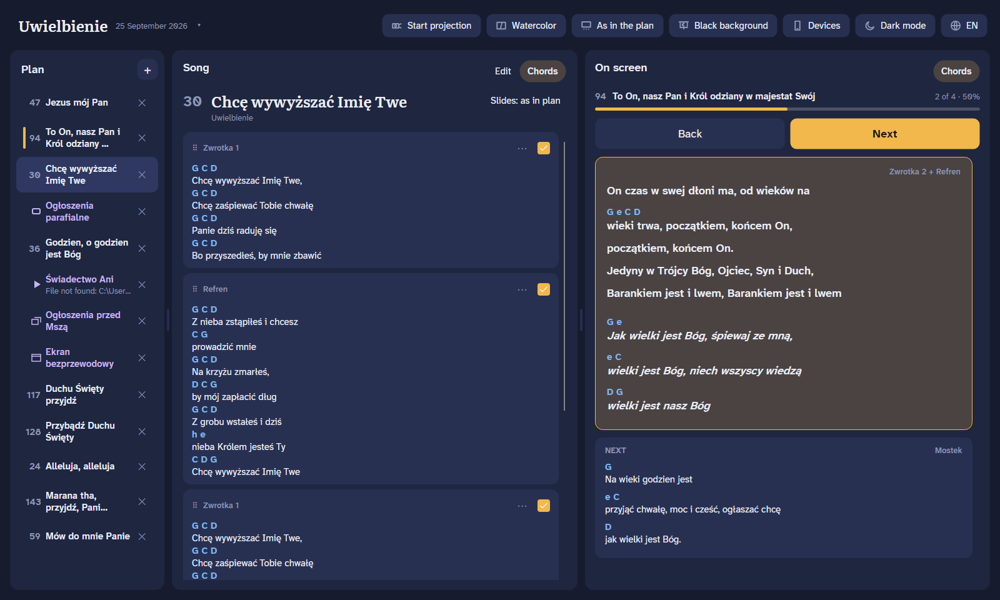
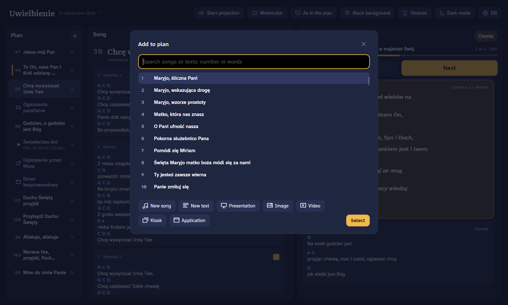
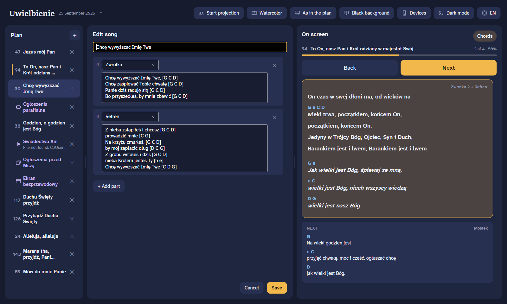
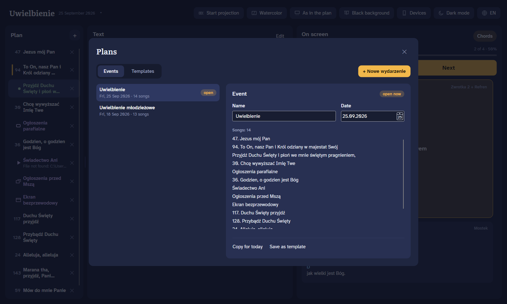
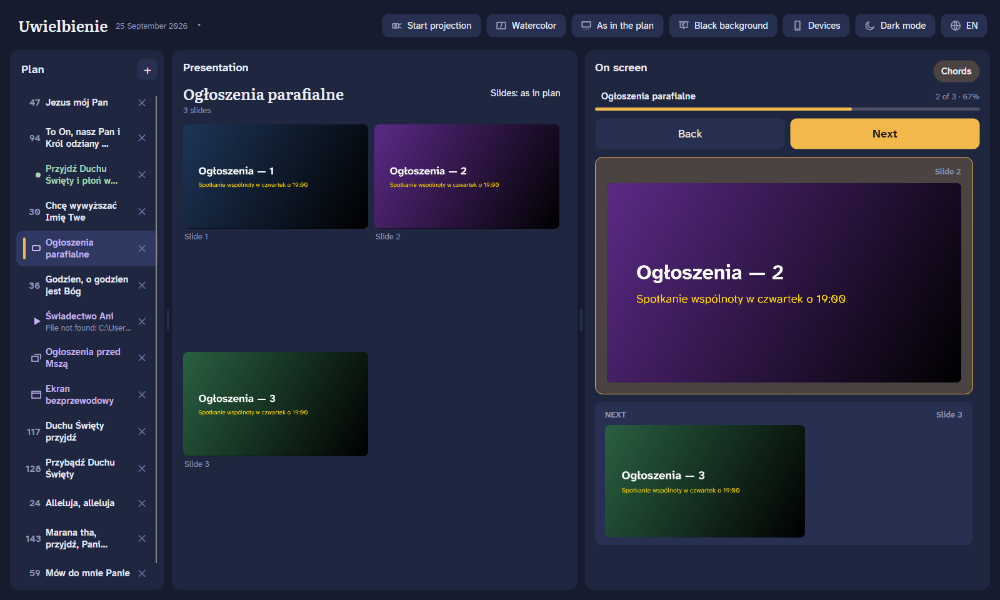
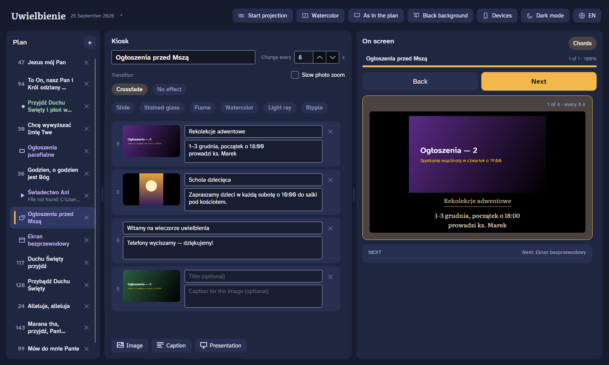

# WorshipBeam

Song projection for worship services. Plan the service, put lyrics on the projector, run it from your phone.

## Features

- **Songbook with chords** – 140+ Polish worship songs built in; add your own songs and texts (Mass parts, prayers, announcements).
- **Service plans** – events and reusable templates; drag to reorder, skip or repeat song parts per plan.
- **Projector output** – full screen on the second display, clean typography, chorus in italics, slide transitions (crossfade, watercolor, flame, light ray…).
- **Presentations, images and videos** – PowerPoint/LibreOffice decks, pictures, any video VLC plays; window capture of other apps (e.g. wireless display).
- **Kiosk** – looping announcements: images and captions with slow zoom.
- **Phone remote and panel** – pair with a QR code; next/back with chords on the phone, full plan control from a tablet or second computer. Encrypted connection.
- **Keystone correction** – fit the image to the projection screen by dragging the corners.
- **Languages** – English, Polski, Magyar, Hrvatski.

## Screenshots

| | |
|---|---|
|  Projection |  Add to plan |
|  Song editor |  Plans and templates |
|  Presentation |  Kiosk |
|  Phone and panel pairing |  Keystone correction |

## Download

Windows installer (auto-updates): [latest release](https://github.com/b-y-t-e/worshipbeam/releases/latest) → `Uwielbienia-win-Setup.exe`.
Linux: `Uwielbienia-<version>-linux-x64.tar.gz` from the same page.

Phone remote and panel: [greysource.eu/worshipbeam](https://greysource.eu/worshipbeam/).

## Build

.NET 10 and Avalonia. `python run.py` builds and runs the app, `python build.py` builds the release. Details: [app/README.md](app/README.md).
